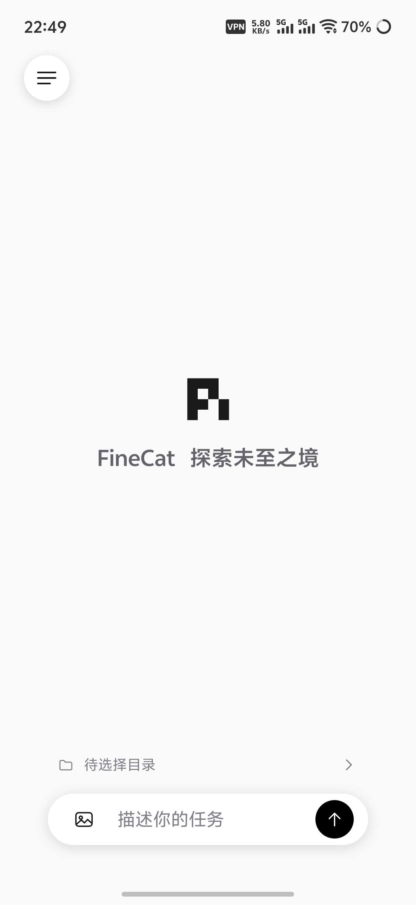
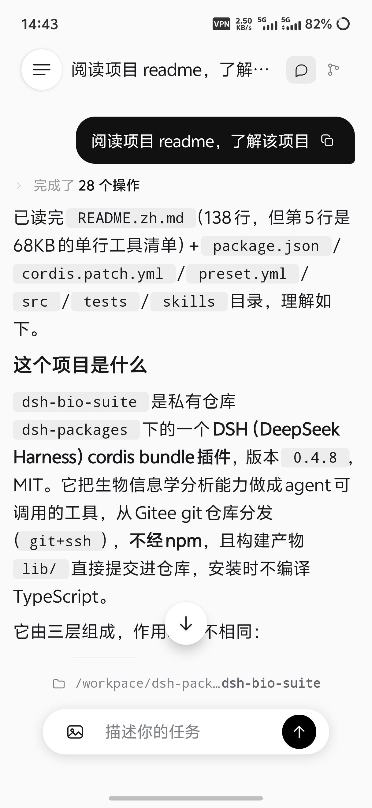
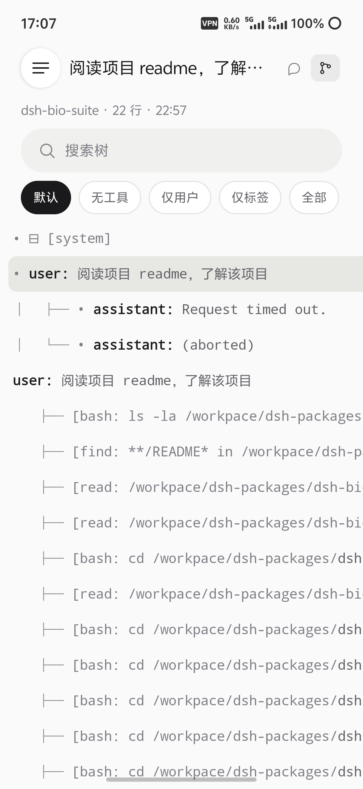
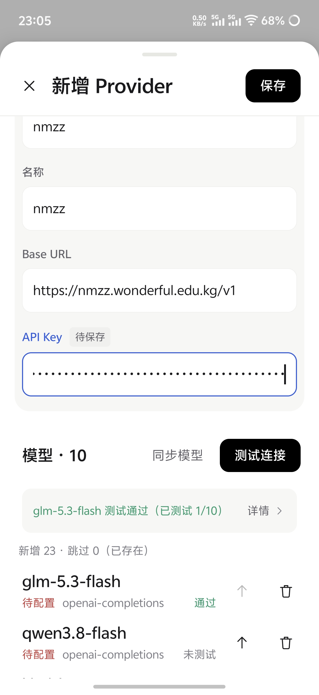

# Pi Mobile

<p align="center">
  <strong>探索未至之境</strong><br>
  <sub>不诱于誉，不恐于诽，率道而行，端然正己</sub><br>
  <sub>为善与众行之，为巧与众能之</sub>
</p>

在手机上用你电脑里跑的 [pi](https://github.com/earendil-works/pi)：发消息、看流式回复与思考过程、看工具调用与 Pi 会话树、切模型与思考档位。

https://github.com/user-attachments/assets/110ed9f9-a819-488e-ac77-33d44402a2b2

链路只在你自己的电脑和手机之间：

```text
Pi Mobile（Android）
   │  设备鉴权 WebSocket
   ▼
pi-mobile-gateway（电脑，Node.js）
   ├─ 网关会话：进程内 Pi SDK
   └─ 原生 Pi：桥接扩展 → Pi CLI（实验性）
```

手机到网关的链路不经过本项目的云端中继，客户端没有账号系统或遥测。网关通过 Pi SDK 调用你选择的模型服务；模型请求、工具和扩展的网络访问遵循宿主 Pi 的配置，不能把这条链路理解为全程离线。

手机不直接连 pi，中间那层网关是姊妹仓库 [pi-mobile-gateway](https://github.com/LiuChen19960902/pi-mobile-gateway)，它跑在 pi 同一台机器上，契约见其 `PROTOCOL.md`。本仓库是 Android 客户端：`androidApp/`（Compose 界面 + 平台能力）与 `shared/`（KMP 协议、投影、同步，不依赖 UI 框架）。

## 界面预览

<table>
  <tr>
    <td align="center">首页</td>
    <td align="center">对话</td>
    <td align="center">会话树</td>
    <td align="center">Provider 配置</td>
  </tr>
  <tr>
    <td></td>
    <td></td>
    <td></td>
    <td></td>
  </tr>
</table>

## 支持的环境

已在 **Windows + WSL2** 和一台 **Ubuntu Linux** 主机上验证手机连接与使用；测试范围见下表。

| 端 | 环境 | 状态 |
| --- | --- | --- |
| 手机 | Android 7.0（API 24）+ | 最低支持版本；当前真机试验为 Android 16（API 36），未逐版本验证 |
| 手机 | iOS | 不做。只有 Android，`shared` 也只编译 Android 目标 |
| 电脑 | Windows + WSL2（pi 与网关都在 WSL2 内） | 日常开发与真机验收环境 |
| 电脑 | Ubuntu 26.04.1 / x86_64 / Node.js 24.21.0，已安装 `fd` | 曾在 gateway 0.3.0 的较早快照验证安装、配对、Provider 配置、真实聊天、工具与历史；最新 Tree 动作及手动压缩未在该主机复验 |
| 电脑 | 纯 Windows（不装 WSL）、macOS、其他 Linux 环境 | 未验证，欢迎反馈 |

版本配套要求：**Android 1.2.0 ↔ gateway 0.5.0（Pi SDK 1.3.0）**。协议在演进，客户端与网关要配套升级。

## 两种连接模式

**网关会话**由网关通过 Pi SDK 独立运行，不需要电脑打开 CLI。**原生 Pi（实验性）**通过桥接扩展接入同一个 CLI 运行实例，手机也可按需后台启动会话，再用 `pi-mobile attach` 从电脑接回。两种模式都通过网关访问宿主配置与会话文件，但网关会话不会实时镜像 CLI，原生模式的接入条件与限制见[兼容说明](Docs/pi-compatibility.md)。

## 开始使用

前置：电脑上已装好 pi 并能正常使用；网关要求 Node.js ≥ 22.19。`@` 文件补全还需要网关运行环境的 `PATH` 中能找到 `fd`；部分发行版将它命名为 `fdfind`，需按网关部署说明配置。

1. **电脑上启动网关并生成配对码**（终端会打印二维码和一段 Base64URL 文本）：

   ```bash
   git clone https://github.com/LiuChen19960902/pi-mobile-gateway.git
   cd pi-mobile-gateway && npm ci
   npm start -- --pair "my phone"
   ```

   网关默认按局域网 IPv4 推断手机可达地址；推断不到时会直接拒绝配对并提示补 `--public-url ws://<手机可达 IP>:3082/ws/mobile`（走 Tailscale 就填 tailnet 地址）。

2. **手机装 App**：从 [正式版 Latest](https://github.com/LiuChen19960902/pi-mobile-android/releases/latest) 下载 1.2.0 长期签名 APK，使用本文的配套网关；原生 Pi 仍属于实验性功能。开发和验收可使用 [1.2.0 Preview](https://github.com/LiuChen19960902/pi-mobile-android/releases/tag/v1.2.0-preview.85)，与正式版同时安装，两者分别配对；构建与签名见[发布说明](Docs/releasing.md)。

3. **配对**：打开 App → 左上角会话列表按钮 → 抽屉顶部设置图标 → 设置页网关卡 → 「扫码配对」或「手动配对」。

配对码一次性、默认 30 分钟过期、网关重启也会作废；配对成功后长期 token 存在 Android Keystore，之后自动重连，不必再扫码。**配对码与 token 都不要贴进公开 issue、群聊或截图**：有效期内拿到它的人就能把自己的设备注册进你的网关。

接管电脑 CLI 会话时，先按[网关的原生 Pi 接入说明](https://github.com/LiuChen19960902/pi-mobile-gateway#连接电脑上的原生-pi)使用 `pi install` 完成一次全局桥接包安装，再在手机“设置 → 连接模式”选择“原生 Pi”。安装后日常直接运行 `pi`；已打开的 CLI 等空闲后 `/reload`，只切换手机模式不会给电脑 CLI 加载扩展。“网关会话”模式不需要这项配置。

使用配套网关时，手机也可独立新建会话，或发送消息以启动已有离线会话，无需先在电脑终端打开它。回到电脑后，用上述网关说明中的附着命令继续同一个后台 Pi；普通 `pi --session` 不等于附着到该运行中的实例。

按场景填网关地址：

| 场景 | 地址 |
| --- | --- |
| 局域网真机 | `ws://<电脑局域网 IP>:3082/ws/mobile` |
| Tailscale 等 mesh VPN | `ws://<Tailscale IP>:3082/ws/mobile` |
| 公网 | `wss://<你的域名>/ws/mobile`（必须 TLS 反代） |
| 模拟器 / `adb reverse` 开发回环 | `ws://127.0.0.1:3080/ws/mobile`（仅开发，非网关默认端口） |

设置页可直接输入 `IP:端口`，自动补齐 `ws://` 与 `/ws/mobile`；公网入口填写完整 `wss://` 地址。当前连接的入口显示绿色状态点，点击延迟可重新测速。

连不上先看 [连接与排错手册](Docs/gateway-connect.md)（含 WSL2 端口如何暴露到局域网 / Tailscale）。

## 能做什么

### 对话与执行

- 发文字、发图片；回复流式渲染 Markdown、思考过程、工具调用，思考与工具可整组折叠
- 长会话按当前会话分支分页加载历史，向上滑补齐；重连后不会丢掉已在电脑上落盘的会话内容，也不会把两条内容相同但实为不同轮的消息误合并
- 发送的图片以紧凑等比例缩略图显示，点开看大图；历史里的图片在换设备或清缓存后仍能按需从网关取回
- 会话页两个视图：对话 / tree（Pi 会话树）。思考与工具执行在对话中展示，结束后收进可展开的 Steps
- tree 支持搜索、筛选、复制条目文本和标签。点击节点先浏览，再从动作卡选择“跳到此处”；跳到 user 节点会回填正文，跳到 assistant 节点只导航并保留现有输入；覆盖手写草稿或附件前会确认。
- 输入框上方可选择 Git worktree、创建新工作区，并选择“Fork 当前会话”“打开已有会话”或“新建空白会话”。打开已有会话会列出目标目录的会话供选择，恢复它自己的草稿，不合并历史。继续会在目标保留完整会话树，源会话仍在；首页选择只设置下一条新会话的目录。需要网关宣告 `worktree-v1`，首次使用未信任项目时在手机确认。
- 模型与思考档位：目录来自网关（按 pi 的可用模型与 `enabledModels` 过滤）；已有会话即时切换，新会话可随首条消息预选；切模型不必重开 App
- 设置页的 `scope-model` 可逐个勾选模型，保存时写入 Pi 全局 `settings.json` 的 `enabledModels`，不切换当前会话模型。改动后点击面板外部也会保存，返回或取消不写；“恢复 Pi 默认范围”表示显示全部可用模型。
- 输入 `/` 选择宿主发现的 Skill 或自定义 Prompt；输入 `@` 补全当前工作目录中的文件和目录，只插入引用，不立即发送。候选依赖网关对应能力；手动输入扩展命令由 SDK 处理，不保证其终端界面或私有后台状态能在手机显示，见 [Pi 支持边界](Docs/pi-compatibility.md)
- 回复进行中可点停止；忙时再发的消息可选注入本轮或排队下轮；尚未执行的待发消息可取回输入框
- 扩展通过 `ctx.ui.setStatus` 发布的提示文本显示在输入区上方（例如「1 agent running」），配盲文动效；不据此判断任务是否仍在运行或已结束
- 点击输入区上下文圆环查看占用，并可手动压缩。压缩通过网关调用宿主 Pi SDK，遵循宿主已加载的压缩扩展钩子；重复触发受限

### 会话与设备

- 首页直接输入即开新会话，输入区上方显示当前工作目录，可打开目录选择器切换；未选择目录时，新建也先回首页，发送前再选目录
- 左侧抽屉管理会话：搜索标题或目录、按目录筛选、折叠日期组、置顶、改名、复制 sessionId；设置与主题按钮在抽屉顶部
- 会话菜单可隐藏单个会话，只影响手机列表，不删电脑文件；隐藏状态重启后仍生效，可随时恢复。目录药丸只负责筛选；旧版本隐藏的目录仍可从隐藏列表恢复
- 同一网关可配多个入口（家里局域网、外出 Tailscale……），按顺序自动试，凭据共用一份
- 网关配置热更新：手机端 provider 增删改、或你在电脑上手改 `models.json` / `settings.json`，下一次读取即生效，无需重启网关

### Provider 管理

- 读写宿主 `~/.pi/agent/models.json`：新增/编辑/删除 provider 与模型，Provider 设默认 Base URL，模型详情可设独立地址或恢复继承；不自动裁加 `/v1`。逐模型设 `api` 协议、compat 开关、思考强度映射、上下文与输出上限
- 模型列表可上移排序，只调整手机视图和测试顺序，不改宿主配置的顺序；本次 App 运行中重开保留，重启 App 后恢复
- 新建 Provider 或修改公共连接时，测试受影响模型，任一通过即可保存；给已有 Provider 新增模型或修改模型 ID、协议、有效地址时，须测试该模型。名称、删除、容量、思考映射等普通参数通过格式校验即可保存。
- 「测试连接」发一次最小生成请求，只验证基础连通；模型详情可单独测试当前模型。失败详情显示模型、协议、HTTP 状态、耗时及排查建议，未测项不会显示为通过。

### 外观

抽屉顶部按钮直接切换浅色 / 深色；正文为 16sp 并尊重系统字体缩放。首页品牌文字可编辑或清空，留空时保留再次编辑的入口。

## 从源码构建

JDK 17 + Android SDK（`compileSdk` / `targetSdk` 36，`minSdk` 24）：

```bash
export JAVA_HOME=/path/to/jdk-17
export ANDROID_HOME=/path/to/android-sdk      # 或写进 local.properties：sdk.dir=...
./gradlew :androidApp:assembleDebug           # 产物 androidApp/build/outputs/apk/debug/androidApp-debug.apk
./gradlew :shared:testAndroidHostTest         # commonTest 跑在 JVM 上
./gradlew :androidApp:testDebugUnitTest       # 含与网关的跨仓库协议一致性测试
```

跨仓一致性测试会把 `pi-mobile-gateway` 当同级目录找（`../pi-mobile-gateway`），也可用 `PI_GATEWAY_DIR` 显式指定；找不到或本机无 node 时这些用例自动跳过。其余参数与 CI 口径见 [CONTRIBUTING.md](CONTRIBUTING.md)。

普通启动默认使用新版 FineCat。日常开发与验收使用独立安装的 Preview 调试包，渠道、签名与正式发布规则见 [发布说明](Docs/releasing.md)。

连上真机后，`./scripts/deploy.sh` 是一条命令的开发循环（构建 → 安装 → `adb reverse` → 启动）。

## 安全边界

完整威胁模型、凭据生命周期与已知取舍见 [SECURITY.md](SECURITY.md)。部署前至少知道这几条：

- 网关进程拥有 pi 的能力：能读写它被授权的工作目录、执行 pi 的工具链。**通过鉴权的手机等于在操作这台机器上的 pi**，不要把端口暴露公网
- 默认走明文 `ws://`，只适合可信局域网；不可信 Wi-Fi 请走 Tailscale；公网必须 `wss://` + TLS
- 长期 token 不过期：清除应用数据或换机只删掉本机副本，服务端仍认为有效，停用设备要在网关侧 `revoke`
- Provider 的 API Key 只写进电脑上的 `~/.pi/agent/models.json`（pi 的原生存储方式，明文文件），手机不保存该 Key
- 不是多租户产品：网关管理面只绑 `127.0.0.1` 且无用户隔离，多用户主机请自行用系统权限收紧

## 文档

- [架构说明](ARCHITECTURE.md) — 分层、一条消息的生命周期、Runtime 的重连/请求关联/背压设计
- [连接与排错](Docs/gateway-connect.md)
- [安全模型与漏洞披露](SECURITY.md)
- [贡献指南](CONTRIBUTING.md)
- [正式构建与升级](Docs/releasing.md)
- [版本记录](CHANGELOG.md)
- [第三方软件声明](Docs/third-party-notices.md)

## 已知限制

- 没有审批 / 提问类交互：pi 扩展发起的审批/提问 UI 请求由网关的 no-op 兜底自动取消，移动端等价物未做；`setStatus` 状态行只显示文本，不提供交互
- CLI 与手机同时操作同一运行会话的协调体验尚未提供；当前网关的多连接订阅不等于完整的多端协同
- macOS、纯 Windows 和其他 Linux 环境未验证；Android 最低版本、折叠屏及无障碍的完整专项覆盖尚未完成
- 会话输入草稿和离线 Provider 草稿只在当前 App 进程内保留，不保证进程被系统终止后恢复；已发送会话以宿主落盘记录为准
- Android 备份与设备迁移规则已排除网关地址偏好与 token；尚未在 Android 12+ 真机上验证迁移向导的实际结果

## 许可与致谢

MIT，见 [LICENSE](LICENSE)。

特别感谢 [Chaofan Li（Clarklevis1995）](https://github.com/Clarklevis1995) 开源的 [dsh-mobile](https://github.com/Clarklevis1995/dsh-mobile)。正是看到这个项目，我才有了把 pi 带到手机上、并将它开源的想法。作者分享的设计与代码，为 Pi Mobile 提供了最初的启发和起点。希望这个项目也能给后来的人一些启发，帮助大家做出自己想要的工具。

KMP 架构与部分移动端实现参考了 [dsh-mobile](https://github.com/Clarklevis1995/dsh-mobile)（MIT，Copyright © Chaofan Li）；本项目不是该仓库的 fork，完整第三方许可声明见 [Docs/third-party-notices.md](Docs/third-party-notices.md)。

首页签名「探索未至之境」引用自 [DeepSeek](https://www.deepseek.com/)。我很钦佩 DeepSeek，也喜欢这句话所表达的求索精神，因此把它用作个人签名，向他们致意。Pi Mobile 基于 pi 构建；签名表达的是作者个人的欣赏与认同，不代表 DeepSeek 官方参与或认可本项目。

本项目是社区客户端，与 pi 官方无关。
